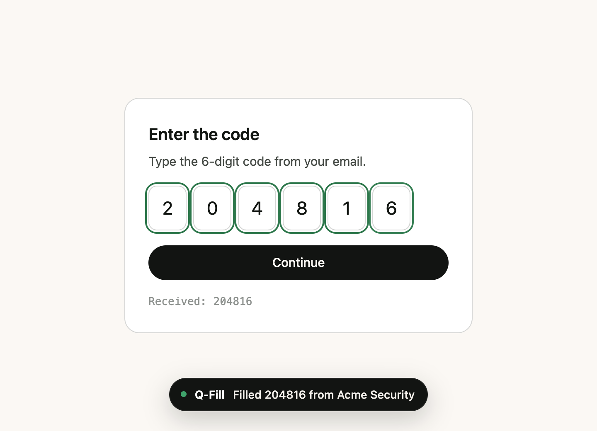
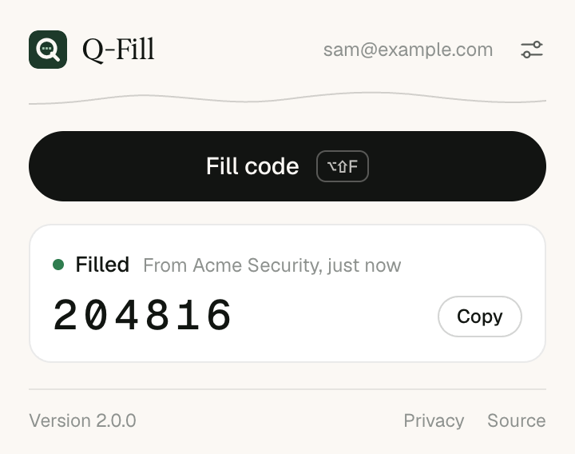
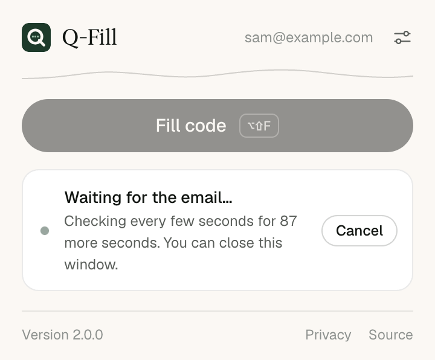

<div align="center">


# Q-Fill for Gmail

Fill the verification code from your newest Gmail message into the page you are on with one click, without your email ever leaving your browser

[](https://github.com/qbeka/Q-Fill-For-Gmail/actions/workflows/ci.yml)
[](LICENSE)




</div>

## What it does

A site emails you a code. Instead of switching to Gmail, finding the email and copying six digits, you press **Fill code** (or <kbd>Alt</kbd>+<kbd>Shift</kbd>+<kbd>F</kbd>) and Q-Fill:

1. Reads your most recent Gmail messages with read-only access.
2. Finds the verification code in the newest one that has a code.
3. Types it into the code field on the page, including split six-box fields, fields in iframes and fields inside web components.

If the email has not arrived yet, Q-Fill keeps checking for 90 seconds and fills the code the moment it lands. You can close the popup and keep working.

<table>
  <tr>
    <td></td>
    <td></td>
  </tr>
</table>

## Why it is built this way

- **Your own OAuth client.** Q-Fill connects to Gmail through a Google OAuth client that you create. No company, including the author, holds a key to your inbox, and there is no server.
- **Nothing runs until you ask.** There is no content script on every site. Q-Fill touches a page only after you click its icon or press its shortcut, through Chrome's `activeTab` permission.
- **Read-only.** The only Gmail scope is `gmail.readonly`. Q-Fill cannot send, change or delete mail.
- **Memory only.** The access token, the last code and the list of emails already used live in `chrome.storage.session`, which the browser clears when it closes. See [PRIVACY.md](PRIVACY.md).
- **No build step.** The `extension/` folder is the extension. It has no runtime dependencies and loads as it is.

## Install

Q-Fill is not in the Chrome Web Store. You load it yourself and connect it to an OAuth client you create, which takes about five minutes once.

1. Download the code: `git clone https://github.com/qbeka/Q-Fill-For-Gmail.git`, or download the ZIP from the green **Code** button and unzip it.
2. Open `chrome://extensions`, turn on **Developer mode**, click **Load unpacked** and pick the **`extension`** folder inside the download.
3. A setup page opens with your redirect URI. Follow [docs/setup.md](docs/setup.md) to create the OAuth client in Google Cloud, then paste its client ID into Q-Fill.
4. Click **Connect Gmail**, pick your account and allow "View your email messages and settings".

Works in Chrome 116 or later. Q-Fill signs in with `chrome.identity.launchWebAuthFlow`, which Edge, Brave, Arc, Vivaldi and Opera also provide, so it should work there too, but the automated tests run on Chromium only.

## Use

| You want to | Do this |
| --- | --- |
| Fill a code | Open the page that asks for it, then click the Q-Fill icon and press **Fill code** |
| Fill without opening the popup | Press <kbd>Alt</kbd>+<kbd>Shift</kbd>+<kbd>F</kbd> (<kbd>Option</kbd>+<kbd>Shift</kbd>+<kbd>F</kbd> on a Mac) |
| Open the popup from the keyboard | Press <kbd>Alt</kbd>+<kbd>Shift</kbd>+<kbd>Q</kbd> |
| Paste the code yourself | Press **Copy** next to the code in the popup |
| Change the shortcuts | Settings, then **Change**, or go to `chrome://extensions/shortcuts` |
| Look further back than 10 minutes | Settings, then **Look back**: 2, 5, 10 or 30 minutes |

Q-Fill never fills the same email twice while the browser is open. If the only code in your inbox is one it already filled, it waits for a new email instead.

If you pressed **Resend** on a site, wait for the new email before pressing Fill. Otherwise Q-Fill may fill the older code, which is still within the look-back window.

## How it finds the right code

Every code-shaped token in the subject and body gets a score from the words around it. "Your code is 482913", "482913 is your Acme code" and a lone number in a large bold table cell score high. A number next to "order", "invoice", "%" or "promo code", a year, a phone number or a price scores low or is dropped. The best token above a threshold wins, and among emails Q-Fill picks the newest one with a code, not the one with the highest score.

It reads codes of 4 to 8 characters: digits (`482913`), spaced or dashed digits (`482 913`, `482-913`), and upper-case letters with digits (`K7Q2ZP`, `XKD-PTQ`). It understands the usual wording in English, Spanish, Portuguese, French, German, Italian, Polish, Russian, Japanese, Chinese and Korean.

On the 71 hand-written test emails in [test/fixtures/emails.js](test/fixtures/emails.js), 49 with a code and 22 without, the extractor gets all 71 right. The 1.x extractor got 44 of the same 71 right and filled years, follower counts and ticket numbers from emails with no code. These fixtures were written alongside the new extractor, some of them from a review that tried to break it, so treat 71 of 71 as a regression baseline, not a measured real-world accuracy. If Q-Fill misses a code in a real email, please [open an issue](https://github.com/qbeka/Q-Fill-For-Gmail/issues/new?template=missed_code.yml) with the wording around the code.

More detail, including how the page field is chosen, is in [docs/how-it-works.md](docs/how-it-works.md).

## Permissions

| Permission | Why |
| --- | --- |
| `identity` | Opens the Google sign-in window (`launchWebAuthFlow`). |
| `storage` | Keeps your client ID, Gmail address and look-back setting, plus the memory-only session data. |
| `activeTab` | Gives Q-Fill access to the current tab only after you click its icon or press its shortcut. |
| `scripting` | Puts the autofill script into that tab when you ask for a code. |
| `https://gmail.googleapis.com/*` | Lists and reads recent messages. |
| `https://oauth2.googleapis.com/*` | Revokes the token when you disconnect. |

There is no `<all_urls>`, no `tabs` permission and no content script on every page.

## Develop

You need Node.js 20 or later.

```bash
npm install
```

```bash
npm test
```

| Command | What it does |
| --- | --- |
| `npm test` | Unit tests for code extraction, message parsing and the search loop (98 tests, under a second) |
| `npm run test:e2e` | Loads the real extension into Chromium and fills every page in `playground/`, then checks which fields the autofill script must and must not touch (31 tests, about 10 seconds). Run `npx playwright install chromium` once first |
| `npm run lint` | ESLint |
| `npm run check` | Lint, unit tests and static checks on `extension/` (manifest paths, strings, store limits, network hosts) |
| `npm run package` | Writes `dist/q-fill-<version>.zip` for the Chrome Web Store or Edge Add-ons |
| `npm run screenshots` | Regenerates the images in `docs/images/` |

The end-to-end tests fake only two things inside the service worker: Gmail's responses and the Google access token. Everything else, from the search loop to script injection to typing into the page, runs for real. To try the autofill by hand, serve the repository with `npx serve` and open `/playground/`.

After you change a file in `extension/`, click the reload icon on Q-Fill's card in `chrome://extensions`.

## Project layout

```
extension/                 the extension, loaded as it is
  manifest.json
  background/              service worker: sign-in, Gmail calls, filling
  core/                    pure logic shared with the tests: extract, parse, search
  content/autofill.js      injected on demand to pick a field and type the code
  popup/                   toolbar popup and first-run setup page
  shared/                  constants and i18n helper
  _locales/en/             every user-facing string
playground/                code forms of many kinds, used by the e2e tests
test/unit/                 node:test unit tests
test/e2e/                  Playwright tests against the real extension
scripts/                   checks, packaging, icons and screenshots
docs/                      setup guide, how it works, images
```

## Limits

- Q-Fill reads text. A code that only appears inside an image is not found.
- Codes longer than 8 characters, and codes in mixed or lower case letters, are not read.
- Pages that block extensions, such as the Chrome Web Store and `chrome://` pages, cannot be filled. The code is still shown in the popup to copy.
- A field inside an iframe from a different site than the page, as on some bank verification steps, cannot be filled, because clicking Q-Fill grants access to the page's own site only. The popup shows the code to copy.
- The Google sign-in window takes focus, so the popup closes while you sign in. Open it again afterwards.
- If the tab moves to a different site while Q-Fill waits for the email, the access you granted by clicking ends. Q-Fill then shows the code in the popup to copy instead of filling it.

## Contributing

Bug reports, missed codes and pull requests are welcome. Start with [CONTRIBUTING.md](CONTRIBUTING.md). For security issues, see [SECURITY.md](SECURITY.md).

## License

[MIT](LICENSE). The bundled Geist fonts are under the SIL Open Font License, see [extension/fonts/LICENSE.txt](extension/fonts/LICENSE.txt).
