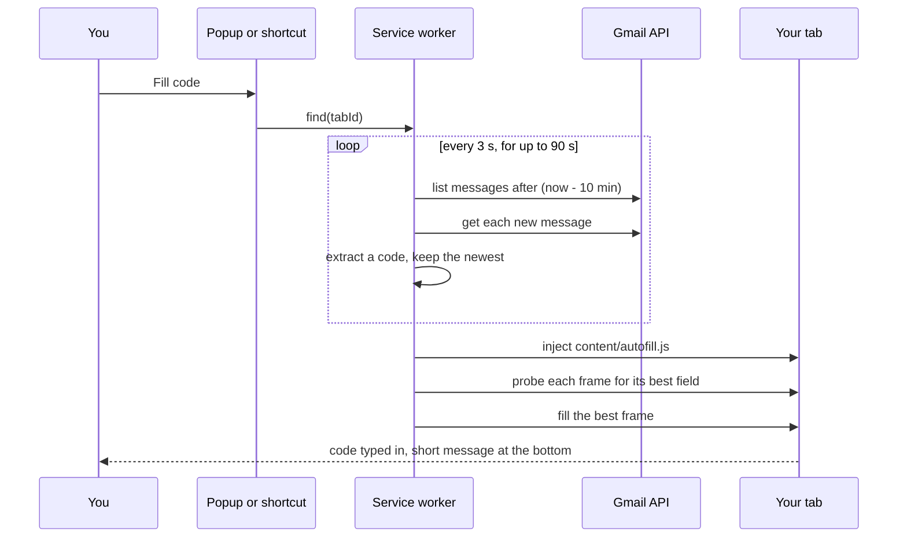

# How Q-Fill works

This page explains what happens between pressing **Fill code** and the code appearing in the page, and where each step lives in the code.



## 1. Starting a run

Clicking the toolbar icon or pressing the shortcut is what gives Q-Fill access to the current tab (`activeTab`). Until then it has no access to any site. The popup sends the tab's ID to the service worker over a long-lived port, and the worker runs the search there, so the run keeps going if you close the popup.

Code: [`background/service-worker.js`](../extension/background/service-worker.js)

## 2. Getting a token

[`background/auth.js`](../extension/background/auth.js) signs in with `chrome.identity.launchWebAuthFlow` and Google's token flow, using your own OAuth client:

- The token is stored in `chrome.storage.session`, which is memory only.
- When it expires (Google's tokens last an hour), Q-Fill first tries a silent refresh with `prompt=none`. Only if that fails does it open the Google window again.
- If you untick the Gmail permission on Google's screen, Q-Fill notices the missing scope and says so, instead of failing later.

`launchWebAuthFlow` was chosen over `chrome.identity.getAuthToken` because it works in every Chromium browser and with any Google account, not only the one signed in to Chrome, and because the client ID can be entered in the popup instead of being baked into `manifest.json`.

## 3. Searching Gmail

[`background/gmail.js`](../extension/background/gmail.js) makes three read-only calls: list messages, get a message, and get your address once when you connect. The list query is:

```
after:<now minus look-back, in seconds> -in:drafts -in:trash -in:chats
```

with spam included, because verification emails sometimes land there. Gmail's `after:` works in whole seconds, so Q-Fill asks for a minute more and then applies the exact cut-off using each message's received time.

[`core/finder.js`](../extension/core/finder.js) runs the loop:

1. List up to 8 recent messages and fetch the ones it has not seen yet, in parallel.
2. Parse each one ([`core/mime.js`](../extension/core/mime.js)): walk the MIME tree, skip attachments, and decode `text/plain` and `text/html` parts with their declared character set.
3. Extract a code from each ([`core/extract.js`](../extension/core/extract.js)).
4. Return the **newest** message that has a code and has not been filled before.
5. If there is none, wait 3 seconds and check again, for up to 90 seconds.

A dropped connection, a rate limit or a Gmail server error does not end the wait: Q-Fill tries again on the next check. If a message fails to load, Q-Fill retries it before it settles for an older code. Errors that will not go away, such as a disabled Gmail API, stop the run at once with a plain explanation.

Emails whose code was filled are remembered by message ID in session memory, so pressing Fill twice never types the same code twice.

## 4. Finding the code in an email

`extractCode({ subject, text, html })` works on the subject and body together.

**Clean up.** HTML becomes text with block elements on their own lines. Entities are decoded. Invisible characters that some senders put between digits (zero-width spaces, soft hyphens, direction marks) are removed. Links and email addresses are removed, because the numbers in them are never the code.

**Find tokens.** A token is 4 to 8 characters: digits, digits split by one space or dash (`482 913`), or upper-case letters with digits (`K7Q2ZP`, `XKD-PTQ`). Look-arounds keep out prices (`$1250`), decimals, dates, times, hashtags and pieces of longer numbers.

**Score each token** from the words around it:

| Signal | Example | Points |
| --- | --- | --- |
| A code label right before it | `Your verification code is 482913`, `Code:\n482913` | 100 |
| A code label right after it | `482913 is your Acme code` | 100 |
| An action phrase | `Use 482913 to sign in` | 90 |
| A label nearby | `code` up to about 120 characters before | 85, falling with distance |
| No label, but the email is clearly about verification | a number in an email that says "verification" | 30 |
| In the subject of a verification email | `Your code: 482913` | +20 |
| Alone on its own line | a code in its own table cell | +25 |
| Large, bold or spaced out in the HTML | `<td style="font-size:32px">482913</td>` | +10 to +20 |
| Another kind of number right before it | `Order #`, `invoice`, `account`, `phone`, `Support PIN` | -70 |
| A meeting invite around it | `Meeting ID`, `Zoom`, `dial-in` | -80 |
| Said to be no longer valid | `111222 has expired` | -60 |
| Marketing words around it | `promo code`, `20% off`, `gift card` | -80 |
| A unit after it | `1250 followers`, `300 points` | -70 |
| Looks like a year | `2026` | -45 |

"Code label" covers English and the common wording in Spanish, Portuguese, French, German (including compounds such as *Bestätigungscode*), Italian, Polish, Russian, Japanese, Chinese and Korean. Phrases such as "promo code", "zip code" and "booking code" do not count as labels.

"Clearly about verification" means words such as verification, one-time, OTP, 2FA or passcode. "Log in" and "sign in" alone are not enough, because marketing emails end with them too, so a lone number on its own line in a newsletter (25 + 30 = 55 points) stays below the threshold.

The best token with at least 60 points wins. If none reaches 60, Q-Fill reports that no code was found rather than guess.

## 5. Filling the page

[`content/autofill.js`](../extension/content/autofill.js) is injected into every frame of the tab that Q-Fill may access. Each frame scores its fields and reports its best one. The worker then fills only the single best frame, so a code never lands in two places.

**Which field.** Every visible, enabled `input`, `textarea` and contenteditable element, including those inside open shadow roots, gets a score:

- `autocomplete="one-time-code"` counts most.
- Fields that ask for some other code are never filled: promo, coupon, voucher, gift card, referral, ZIP and postal code, country code, search, card number, CVV and captcha. A password field is filled only when it is marked as a one-time code.
- One segment of a split number, such as a card number in four boxes of four, is never filled on its own.
- Words in the field's attributes and label: "otp", "verification code", "2fa" and similar count for it, while "email", "password", "search", "promo" and similar count against it.
- `maxlength` equal to the code length, `inputmode="numeric"`, a digit `pattern`, and being the focused field all count for it.

Rows of 4 to 8 small single-character boxes are recognised as one split code field when they line up horizontally with similar sizes.

**How it types.** For each field Q-Fill selects the contents and uses `document.execCommand('insertText')`, which fires the same input events as typing, so React, Vue and Angular forms see the change. If the page ignores that, it falls back to the native value setter plus `input` and `change` events. For split boxes it types one character per box, and if the widget expects a paste instead, it sends a paste event with the whole code. Every fill is checked by reading the values back, and Q-Fill only reports success if they match.

## 6. What Q-Fill stores

| Where | What | How long |
| --- | --- | --- |
| `chrome.storage.local` | Your OAuth client ID and the look-back setting | Until you change them or remove the extension |
| `chrome.storage.local` | Your Gmail address, shown in the popup | Until you disconnect |
| `chrome.storage.session` | The access token, the last result shown in the popup, IDs of emails already filled | Until the browser closes |

Email bodies are never stored. They exist in memory only while a message is being scanned.
